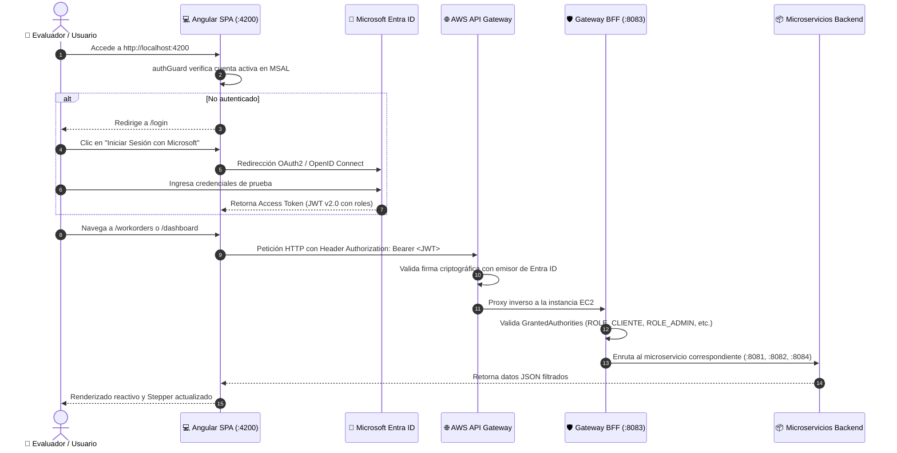

# 💻 DigitalFix - Frontend Angular SPA

[](https://angular.dev/)
[](https://www.typescriptlang.org/)
[](https://learn.microsoft.com/en-us/entra/identity-platform/)
[](https://aws.amazon.com/api-gateway/)
[](https://pnpm.io/)
[](https://vitest.dev/)

Aplicación web **Single Page Application (SPA)** desarrollada con **Angular** y **TypeScript**, diseñada para la plataforma de mantención y soporte técnico **DigitalFix**.

Provee una interfaz moderna y reactiva con control de acceso basado en roles (**RBAC**), autenticación federada con **Microsoft Entra ID** (OAuth2 / OIDC), integración segura con el backend en AWS mediante **API Gateway & Spring Cloud Gateway BFF**, y seguimiento visual en tiempo real del ciclo de vida de las órdenes mediante un componente interactivo de tipo **Stepper**.

---

## 👨‍🏫 Guía Rápida para el Evaluador / Docente

Para desplegar y evaluar el frontend en su entorno local, siga los siguientes pasos:

### 1. Requisitos Previos
* **Node.js**: Versión 18, 20 o superior ([Descargar Node.js](https://nodejs.org/)).
* **Gestor de Paquetes**: `pnpm` (recomendado) o `npm`.
  *(Si no tiene `pnpm`, puede instalarlo con `npm install -g pnpm` o utilizar los comandos estándar de `npm`).*

### 2. Clonar e Instalar Dependencias

```bash
# Clonar el repositorio
git clone https://github.com/Fabian-Armijo/Frontend-DigitalFix.git
cd Frontend-DigitalFix

# Instalar dependencias
pnpm install
# O si prefiere npm:
# npm install
```

### 3. Iniciar el Servidor de Desarrollo

```bash
pnpm start
# O alternativamente:
# npm start
# ng serve
```

Una vez iniciado, abra su navegador web e ingrese a:
👉 **`http://localhost:4200`**

> **Nota:** La aplicación ya viene preconfigurada para conectarse directamente al backend desplegado en la nube de **AWS (API Gateway + EC2)**. No requiere levantar el backend localmente para probar el frontend.

---

## 🔐 Cuentas de Acceso para Pruebas (Microsoft Entra ID)

La aplicación utiliza autenticación corporativa con **Microsoft Entra ID**. Se han configurado cuentas de demostración para evaluar cada uno de los roles del sistema:

| Rol | Cuenta de Acceso | Contraseña | Funcionalidad en la Evaluación |
| :--- | :--- | :--- | :--- |
| **`ADMIN`** | `admin@<dominio>.onmicrosoft.com` | *(Ver notas)* | Acceso total al catálogo de servicios y repuestos, gestión de stock, tarifas y métricas. |
| **`SUPERVISOR`** | `supervisor@<dominio>.onmicrosoft.com` | *(Ver notas)* | Mesa de operaciones: bandeja de órdenes, asignación de técnicos especialistas y avance de fases. |
| **`CLIENTE 1`** | `cliente1@<dominio>.onmicrosoft.com` | *(Ver notas)* | Portal de autoatención: ingreso de solicitudes de mantención y seguimiento visual con Stepper. |
| **`CLIENTE 2`** | `cliente2@<dominio>.onmicrosoft.com` | *(Ver notas)* | Demostración de **aislamiento de datos**: solo visualiza sus propias solicitudes (`Orden #1`, etc.). |

> 📌 **Nota sobre credenciales:**  
> Las contraseñas de las cuentas de prueba institucionales se encuentran detalladas en el **informe de entrega / plataforma académica (Blackboard)**.

---

## 🏛️ Arquitectura del Frontend y Flujo de Autenticación

El frontend utiliza la biblioteca oficial `@azure/msal-angular` para gestionar el flujo seguro **Authorization Code Flow con PKCE**:



---

## 📂 Estructura de Directorios

```text
Frontend-DigitalFix/
├── src/
│   ├── app/
│   │   ├── components/
│   │   │   ├── catalog/         # Catálogo de servicios técnicos y repuestos (Admin)
│   │   │   │   ├── catalog.html # Grilla de servicios, tarjetas de repuestos y control de stock
│   │   │   │   └── catalog.ts   # Conexión con /api/catalog/services y /spare-parts
│   │   │   ├── dashboard/       # Panel de control de Supervisión y Administración
│   │   │   │   ├── dashboard.html # KPIs, bandeja de órdenes, modal de asignación de técnicos
│   │   │   │   └── dashboard.ts # Operaciones PATCH de asignación y cambios de estado
│   │   │   ├── layout/          # Estructura principal (Sidebar y Navbar)
│   │   │   │   ├── layout.html  # Menú adaptativo según roles y perfil del usuario
│   │   │   │   └── layout.ts    # Control de cierre de sesión y visualización de usuario activo
│   │   │   ├── login/           # Pantalla de inicio de sesión público
│   │   │   │   ├── login.html   # Interfaz corporativa con botón de Microsoft
│   │   │   │   └── login.ts     # Invocación de msalService.loginRedirect()
│   │   │   └── workorders/      # Portal del Cliente
│   │   │       ├── workorders.html # Formulario de mantención y Stepper interactivo
│   │   │       └── workorders.ts   # Aislamiento por customerId y creación POST /workorders
│   │   ├── core/
│   │   │   ├── guards/
│   │   │   │   └── auth-guard.ts   # Protección de rutas privadas contra usuarios anónimos
│   │   │   └── interceptors/
│   │   │       └── token-interceptor.ts # Interceptor HTTP
│   │   ├── app.config.ts        # Inyección de dependencias de MSAL e Interceptor Bearer
│   │   ├── app.routes.ts        # Definición de rutas y asignación de guards
│   │   └── app.ts               # Componente raíz con router-outlet
│   ├── environments/
│   │   ├── environment.ts       # Configuración para entorno de producción / AWS
│   │   └── environment.development.ts # Configuración para desarrollo local
│   └── styles.scss              # Estilos globales y paleta de colores corporativa
├── angular.json                 # Configuración del CLI de Angular
├── package.json                 # Dependencias y scripts de ejecución
└── tsconfig.json                # Configuración de compilación de TypeScript
```

---

## ⚙️ Configuración de Entornos (`environment.ts`)

Las variables de conexión se encuentran centralizadas en `src/environments/environment.ts`:

```typescript
export const environment = {
  production: false,
  msalConfig: {
    auth: {
      clientId: '088bf033-6ebb-441c-862d-7b6fcc60a5e8',       // ID de registro en Azure
      authority: 'https://login.microsoftonline.com/cac38dd3-e614-48df-967a-3c9e4396eae3', // Tenant ID
      redirectUri: 'http://localhost:4200/',
      postLogoutRedirectUri: 'http://localhost:4200/login'
    }
  },
  api: {
    bffUrl: 'https://y9alroweth.execute-api.us-east-1.amazonaws.com/api', // AWS API Gateway
    scope: 'api://e0877608-03e1-4d4b-a0c9-d50d0ddbdb7c/access_as_user'     // Scope OAuth2 backend
  }
};
```

### 🔄 ¿Cómo alternar entre AWS y Backend Local?
Si el evaluador desea correr el backend localmente con Docker Compose en lugar de apuntar a la nube de AWS:
1. Abra `src/environments/environment.ts`.
2. Modifique la propiedad `bffUrl`:
   ```typescript
   bffUrl: 'http://localhost:8083/api' // Backend local vía Spring Cloud Gateway
   ```
3. Guarde el archivo; Angular recargará la aplicación en caliente (*hot-reload*).

---

## 🎯 Vistas y Módulos Principales

### 1. Portal del Cliente (`/workorders`)
* **Solicitud de Mantención:** Formulario intuitivo donde el cliente describe el equipo, detalle de la falla, notas adicionales y servicio técnico sugerido.
* **Aislamiento Multi-Cliente:** Cada cliente autenticado (`cliente1`, `cliente2`) visualiza de forma estricta sus propias órdenes sin interferencia con otros usuarios.
* **Numeración Secuencial Amigable:** Las órdenes se despliegan numeradas correlativamente (`Orden #1`, `Orden #2`, etc.) para mayor claridad del cliente.
* **Stepper en Vivo de 5 Etapas:**
  1. *Solicitud Creada* (`CREADA`)
  2. *Técnico Asignado* (`ASIGNADA`)
  3. *En Desplazamiento* (`EN_DESPLAZAMIENTO`)
  4. *En Reparación* (`EN_EJECUCION`)
  5. *Servicio Concluido* (`CERRADA`)

### 2. Panel de Operaciones y Dashboard (`/dashboard`)
* Exclusivo para roles `SUPERVISOR` y `ADMIN`.
* **Tarjetas KPI:** Contadores en tiempo real de órdenes totales, mantenciones en proceso, órdenes cerradas y técnicos disponibles.
* **Bandeja de Asignación:** Permite seleccionar cualquier orden en estado `CREADA` y asignarle un técnico especialista disponible.
* **Gestión de Fases:** Botones de acción rápida para avanzar el estado operacional de la orden conforme progresa la visita técnica.

### 3. Catálogo y Repuestos (`/catalog`)
* Exclusivo para rol `ADMIN`.
* **Servicios Técnicos:** Visualización y mantención de tarifas bases por tipo de servicio (diagnóstico, mantención preventiva, cambio de pantalla, etc.).
* **Inventario de Repuestos:** Monitoreo de stock con alertas visuales de repuestos críticos y costos unitarios.

---

## 🧪 Pruebas y Compilación para Producción

### Ejecutar Pruebas Unitarias
El proyecto utiliza **Vitest** y **JSDom** para pruebas rápidas y reactivas:
```bash
pnpm test
# o: npm test
```

### Compilar para Producción
Para generar el paquete optimizado y minificado de producción:
```bash
pnpm run build
# o: npm run build
```
Los archivos finales se generarán en la carpeta `dist/frontend-digitalfix/browser/`, listos para ser desplegados en cualquier servidor web estático (AWS S3 + CloudFront, Nginx, Vercel o Netlify).

---

## 🛠️ Tecnologías Empleadas

| Categoría | Tecnología | Versión | Propósito |
| :--- | :--- | :--- | :--- |
| **Framework SPA** | Angular | `22.x` | Arquitectura basada en componentes reactivos y señales |
| **Lenguaje** | TypeScript | `5.x` | Tipado estático estricto y mantenibilidad |
| **Seguridad / Identidad** | MSAL Angular & Browser | `^6.2.1` / `^5.22.0` | Integración estándar con Microsoft Entra ID (OIDC) |
| **Estilos** | SCSS / Flexbox / Grid | Nativo | Diseño responsivo, paleta moderna y componentes a medida |
| **API Client** | Angular HttpClient | Nativo | Interceptores automáticos de Bearer Tokens |
| **Testing** | Vitest & JSDom | `^4.0.8` | Ejecución ágil de pruebas unitarias |
| **Gestor de Paquetes** | PNPM | `10.20.0` | Instalación ultrarrápida y optimizada de dependencias |
